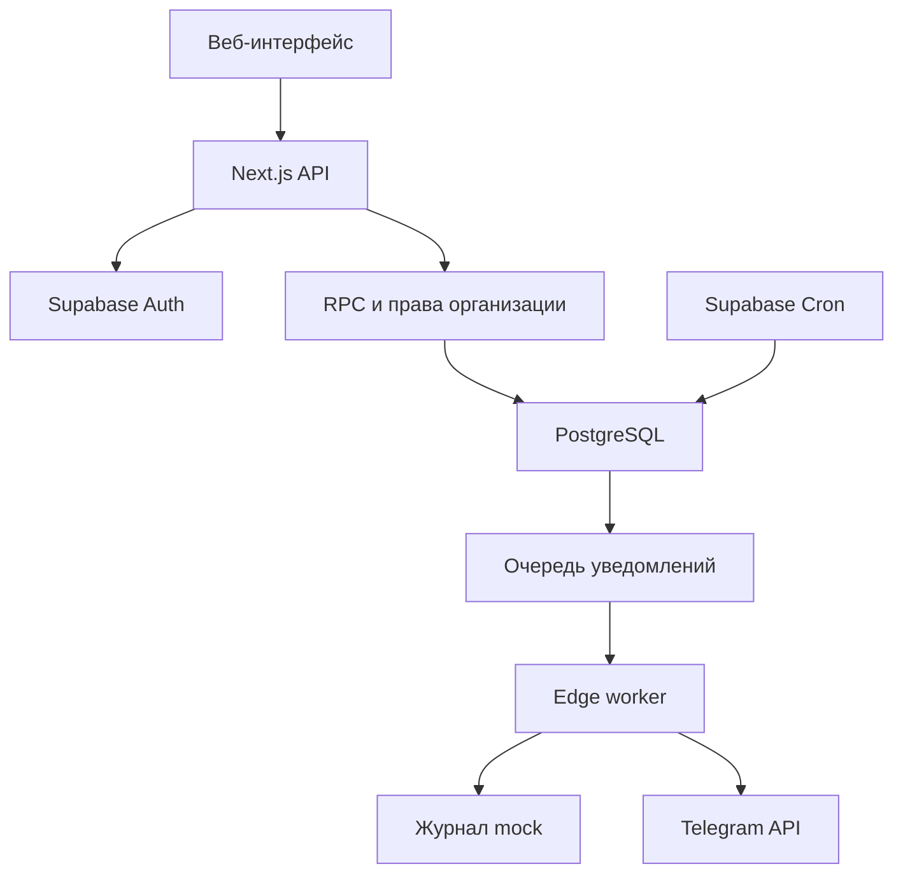

# Архитектура EduSafe

## Адаптация к Vercel и Supabase

Next.js App Router отдаёт страницы, проверяет пользователя через Supabase Auth и выполняет серверные маршруты. Веб-приложение не использует service role. Cookies имеют HttpOnly, SameSite и Secure на рабочем HTTPS-размещении. Изменяющие JSON-запросы требуют совпадения Origin.

PostgreSQL хранит организации, роли, учебные занятия, исходные отметки, подтверждённый журнал, тревоги и задания уведомлений. Публичные таблицы защищены RLS и не принимают прямые клиентские записи. Публичные RPC — ограниченный интерфейс к функциям приватной схемы, где повторно проверяются текущие назначения пользователя. Роли не берутся из редактируемых пользователем metadata.

## Важные границы

- `CheckIn` — предъявление действующего токена авторизованным учеником; `Attendance` — состояние журнала после решения преподавателя.
- Один QR используется несколькими учениками. Уникальность отметки ученика обеспечивается ограничением БД.
- Событие тревоги, отправка каналу и подтверждение сотрудником — разные состояния.
- Изменение данных и очередь уведомлений создаются в одной транзакции.
- Обработчик использует аренду задания и проверку актуальности перед отправкой. Потеря ответа Telegram может привести к повтору внешнего сообщения, но не к новой логической тревоге.
- Родитель получает доступ только после подтверждения связи. Для взрослого учащегося требуется отдельное разрешение.
- Публичная демонстрация хранит синтетические изменения локально. Она не является обходом авторизации рабочего приложения.

## Структура

| Путь | Назначение |
|---|---|
| `src/app` | Страницы, авторизация, QR, сканер, API |
| `src/components` | Лендинг и пространство школы |
| `src/lib` | Типы, Supabase SSR, безопасность, демонстрация, переводы |
| `supabase/migrations` | Схема, RLS, бизнес-операции, задачи |
| `supabase/functions` | Обработчик уведомлений и Telegram webhook |
| `tests` | Проверки клиентских границ и БД |

## Развитие

Для большого количества учреждений потребуется пагинация широких журналов, отдельные read-модели аналитики и эксплуатационные метрики. Подключение пропускной системы, SMS и телефонии выполняется через адаптеры после выбора оборудования и провайдера. Эти функции не имитируются в текущем MVP.
